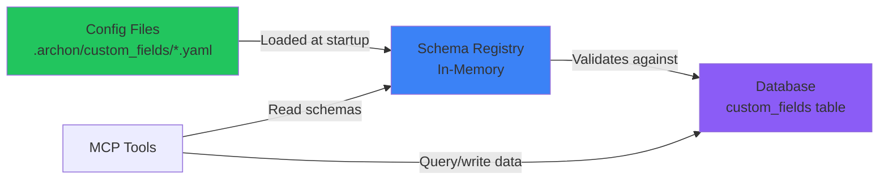
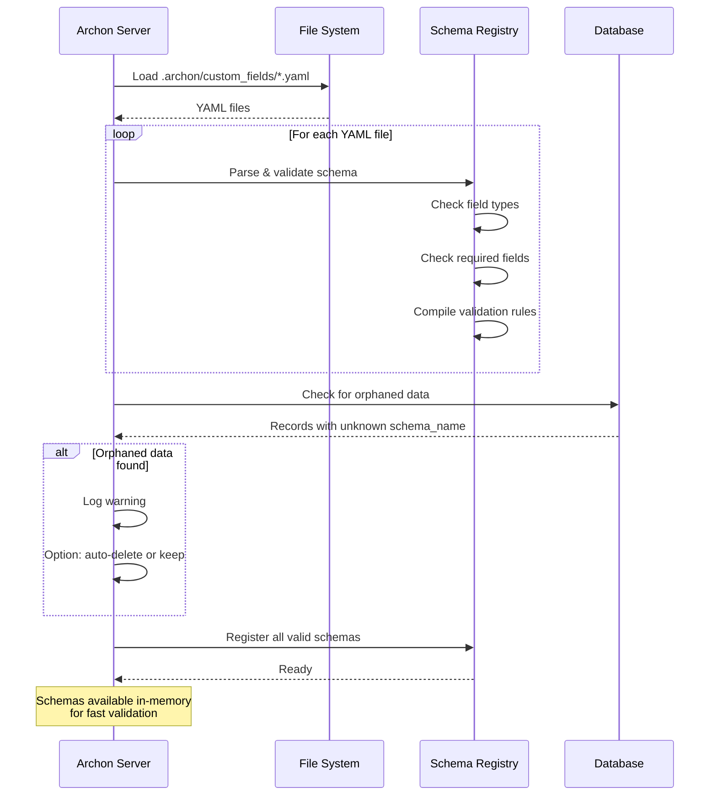

# Custom Fields System - Config-First Design

> **Core Concept**: Define custom fields in YAML config files, store data in DB, use generic filtering in MCP tools. No code changes needed for new fields.

---

## Design Philosophy

### User Experience
```
1. User creates .archon/custom_fields/time_tracking.yaml
2. Defines fields (estimated_hours, actual_hours, billable)
3. Rebuilds container (or restarts server)
4. Fields automatically available in MCP tools
5. AI knows about fields by reading config
```

**No UI needed. No schema management API. Just YAML files.**

---

## Architecture: Config Files vs Database Tables

### Hybrid Approach (Recommended)



**Split responsibilities:**
- **Config files** = Schema definitions (what fields exist)
- **Database table** = Actual data (field values for each task/project)

### Config Files: Pros & Cons

**Pros:**
✅ Git-trackable - See what changed in PRs
✅ Easy to edit - Just text files
✅ Version controlled - Rollback schema changes
✅ Shareable - Copy configs between deployments
✅ Infrastructure as code - Schema = code
✅ No UI needed - Developers love config files
✅ AI can read them - MCP tool can expose schemas
✅ Declarative - Clear source of truth

**Cons:**
❌ Requires restart to apply changes (not a big deal for local deployment)
❌ Not suitable for multi-tenant (Archon is single-user, so fine)
❌ Can't have dynamic schemas (not a use case anyway)

### Database Table: Why Still Needed

**You still need DB for the actual data:**
- Performant queries (indexed, JSONB)
- Relational integrity (cascade deletes)
- Transactional updates (with tasks/projects)
- Complex filtering (WHERE clauses)

**But the schema definition moves to config files.**

---

## Config File Structure

### Directory Layout

```
.archon/
├── custom_fields/
│   ├── time_tracking.yaml
│   ├── jira_sync.yaml
│   ├── budget_tracking.yaml
│   └── README.md
└── webhooks/
    ├── harvest_integration.yaml
    └── jira_integration.yaml
```

### Example Schema: Time Tracking

**`.archon/custom_fields/time_tracking.yaml`**

```yaml
# Schema metadata
name: time_tracking
description: Track estimated and actual time for billing
entity_type: tasks  # tasks | projects | sources
version: 1.0

# Field definitions
fields:
  estimated_hours:
    type: number
    label: Estimated Hours
    description: Time estimate for planning
    min: 0
    max: 1000
    required: false
    filterable: true  # Can be used in find_tasks filters
    default: null

  actual_hours:
    type: number
    label: Actual Hours
    description: Time actually spent
    min: 0
    required: false
    filterable: true
    default: null

  billable:
    type: boolean
    label: Billable?
    description: Should this be billed to client?
    required: false
    filterable: true
    default: true

  hourly_rate:
    type: number
    label: Hourly Rate
    description: Rate for billing calculations
    min: 0
    required: false
    filterable: false  # Not useful for filtering

# Webhook configuration (Pattern 1: outgoing only)
webhook:
  enabled: true
  url: https://zapier.com/hooks/catch/12345/abcdef
  trigger_on: [create, update]  # When to send webhooks
  headers:
    Authorization: Bearer ${HARVEST_API_KEY}  # Env var substitution
    Content-Type: application/json
```

### Example Schema: JIRA Sync

**`.archon/custom_fields/jira_sync.yaml`**

```yaml
name: jira_sync
description: Link tasks to JIRA issues
entity_type: tasks
version: 1.0

fields:
  jira_id:
    type: text
    label: JIRA Issue ID
    description: e.g. PROJ-123
    pattern: '^[A-Z]+-[0-9]+$'  # Regex validation
    required: false
    filterable: true

  jira_status:
    type: select
    label: JIRA Status
    description: Synced from JIRA
    options:
      - To Do
      - In Progress
      - In Review
      - Done
    required: false
    filterable: true

  jira_url:
    type: text
    label: JIRA URL
    description: Direct link to issue
    required: false
    filterable: false

webhook:
  enabled: true
  url: https://automation.atlassian.com/webhooks/inbound/${JIRA_WEBHOOK_ID}
  trigger_on: [create, update]
  headers:
    X-Atlassian-Token: nocheck
```

### Example Schema: Budget Tracking (for Projects)

**`.archon/custom_fields/budget_tracking.yaml`**

```yaml
name: budget_tracking
description: Track project budgets and costs
entity_type: projects  # Applied to projects, not tasks
version: 1.0

fields:
  budget:
    type: number
    label: Budget
    description: Total project budget
    min: 0
    required: false
    filterable: true

  actual_cost:
    type: number
    label: Actual Cost
    description: Money spent so far
    min: 0
    required: false
    filterable: true

  client_name:
    type: text
    label: Client Name
    required: false
    filterable: true

  deadline:
    type: date
    label: Project Deadline
    required: false
    filterable: true

  priority:
    type: select
    label: Priority
    options: [low, medium, high, critical]
    required: false
    filterable: true
    default: medium

webhook:
  enabled: false  # No webhook for this schema
```

---

## Database Schema (Simplified)

### Single Table: custom_fields

```sql
CREATE TABLE custom_fields (
  id UUID PRIMARY KEY DEFAULT gen_random_uuid(),

  -- Polymorphic link
  entity_type TEXT NOT NULL CHECK (entity_type IN ('tasks', 'projects', 'sources')),
  entity_id UUID NOT NULL,

  -- Schema reference (from config file name)
  schema_name TEXT NOT NULL,  -- e.g., 'time_tracking'

  -- All field values in JSONB
  fields JSONB NOT NULL DEFAULT '{}'::jsonb,

  created_at TIMESTAMPTZ DEFAULT NOW(),
  updated_at TIMESTAMPTZ DEFAULT NOW(),

  -- One record per entity per schema
  UNIQUE(entity_type, entity_id, schema_name)
);

-- Critical indexes
CREATE INDEX idx_custom_fields_entity ON custom_fields(entity_type, entity_id);
CREATE INDEX idx_custom_fields_schema ON custom_fields(schema_name);
CREATE INDEX idx_custom_fields_values_gin ON custom_fields USING GIN(fields);
```

**Why this is better:**
- No separate `schemas` table (schemas are in config files)
- `schema_name` references config file name
- On startup, server validates that all `schema_name` values have corresponding YAML files

---

## Generic MCP Tool Filtering

### Universal Parameter: custom_fields

**Existing tools enhanced with ONE generic parameter:**

```python
@mcp.tool()
async def find_tasks(
    ctx: Context,
    query: str | None = None,
    task_id: str | None = None,
    filter_by: str | None = None,
    filter_value: str | None = None,
    project_id: str | None = None,
    include_closed: bool = True,
    custom_fields: dict | None = None,  # ← ADDED: Generic custom field filtering
    page: int = 1,
    per_page: int = 10,
) -> str:
    """
    Find and search tasks.

    Args:
        ... existing args ...
        custom_fields: Filter by custom fields defined in .archon/custom_fields/*.yaml
                       Uses Django-style operators for filtering:
                       - {"estimated_hours__gte": 5} = estimated_hours >= 5
                       - {"billable": true} = exact match
                       - {"jira_id__icontains": "PROJ"} = contains (case-insensitive)

                       Available operators:
                       - __eq or no suffix: exact match (default)
                       - __gte: greater than or equal
                       - __gt: greater than
                       - __lte: less than or equal
                       - __lt: less than
                       - __contains: contains substring
                       - __icontains: contains substring (case-insensitive)
                       - __in: value in list

                       Available fields depend on loaded schemas. Current schemas:
                       {list of loaded schema names and their filterable fields}

    Examples:
        find_tasks(custom_fields={"estimated_hours__gte": 5})
        find_tasks(custom_fields={"billable": true, "actual_hours__lt": 10})
        find_tasks(custom_fields={"jira_id": "PROJ-123"})
    """
```

**Implementation:**

```python
# Inside find_tasks function
if custom_fields:
    # schema_registry loaded from YAML files at startup
    for field_key, field_value in custom_fields.items():
        # Parse operator (e.g., "estimated_hours__gte" → field="estimated_hours", op="gte")
        field_name, operator = parse_field_operator(field_key)

        # Validate field exists in a schema and is filterable
        if not schema_registry.is_filterable(field_name):
            return error(f"Field '{field_name}' is not filterable")

        # Apply JSONB filter
        if operator == "gte":
            query = query.filter(f"fields->>'{field_name}' >= {field_value}")
        elif operator == "eq":
            query = query.filter(f"fields->>'{field_name}' = {field_value}")
        # ... etc
```

### AI Knows Available Fields Automatically

**The AI can call a helper tool to discover schemas:**

```python
@mcp.tool()
async def get_custom_field_schemas(
    ctx: Context,
    entity_type: str | None = None  # Optional filter
) -> str:
    """
    List all custom field schemas available for filtering.

    Returns schema names, field definitions, and descriptions from
    .archon/custom_fields/*.yaml config files.

    Use this to discover what custom_fields filters are available
    for find_tasks, find_projects, etc.

    Args:
        entity_type: Optional filter (tasks | projects | sources)
    """
    schemas = schema_registry.get_all_schemas(entity_type)

    return json.dumps({
        "schemas": [
            {
                "name": schema.name,
                "entity_type": schema.entity_type,
                "fields": {
                    field_name: {
                        "type": field.type,
                        "label": field.label,
                        "filterable": field.filterable,
                        "description": field.description
                    }
                    for field_name, field in schema.fields.items()
                }
            }
            for schema in schemas
        ]
    })
```

**AI workflow:**
```
1. AI wants to filter tasks by estimated hours
2. AI calls get_custom_field_schemas(entity_type="tasks")
3. Sees "time_tracking" schema has "estimated_hours" field (filterable: true)
4. AI calls find_tasks(custom_fields={"estimated_hours__gte": 5})
```

---

## manage_task Enhancement

### Creating/Updating with Custom Fields

```python
@mcp.tool()
async def manage_task(
    ctx: Context,
    action: str,
    task_id: str | None = None,
    project_id: str | None = None,
    title: str | None = None,
    description: str | None = None,
    status: str | None = None,
    assignee: str | None = None,
    custom_fields: dict | None = None,  # ← ADDED: Generic custom field data
) -> str:
    """
    Manage tasks (create/update/delete).

    Args:
        ... existing args ...
        custom_fields: Custom field values to set. Format:
                       {"schema_name.field_name": value}

                       Examples:
                       {"time_tracking.estimated_hours": 8}
                       {"time_tracking.billable": true}
                       {"jira_sync.jira_id": "PROJ-123"}

                       Schema and field validation happens automatically.
                       Invalid schemas or fields will return an error.
    """
    if custom_fields:
        # Group by schema
        custom_by_schema = parse_custom_fields(custom_fields)
        # Result: {"time_tracking": {"estimated_hours": 8}, "jira_sync": {"jira_id": "PROJ-123"}}

        for schema_name, fields in custom_by_schema.items():
            # Validate against YAML schema
            schema = schema_registry.get_schema(schema_name)
            schema.validate(fields)  # Raises error if invalid

            # UPSERT to database
            await custom_fields_service.upsert(
                entity_type="tasks",
                entity_id=task_id,
                schema_name=schema_name,
                fields=fields
            )

            # Trigger webhook if configured
            if schema.webhook.enabled:
                await webhook_service.queue(schema, entity_id, fields)
```

---

## Schema Loading & Validation

### Startup Process



### Schema Registry Implementation

```python
# python/src/server/services/custom_fields/schema_registry.py

class SchemaRegistry:
    """
    Loads and manages custom field schemas from YAML files.
    Singleton - loaded once at startup.
    """

    def __init__(self, config_dir: Path = Path(".archon/custom_fields")):
        self.schemas: Dict[str, CustomFieldSchema] = {}
        self.load_all_schemas(config_dir)

    def load_all_schemas(self, config_dir: Path):
        """Load all YAML files from config directory"""
        if not config_dir.exists():
            logger.warning(f"Custom fields config directory not found: {config_dir}")
            return

        for yaml_file in config_dir.glob("*.yaml"):
            try:
                schema = CustomFieldSchema.from_yaml(yaml_file)
                self.schemas[schema.name] = schema
                logger.info(f"Loaded custom field schema: {schema.name}")
            except Exception as e:
                logger.error(f"Failed to load schema {yaml_file}: {e}")

    def get_schema(self, name: str) -> CustomFieldSchema:
        """Get schema by name"""
        if name not in self.schemas:
            raise ValueError(f"Unknown custom field schema: {name}")
        return self.schemas[name]

    def get_filterable_fields(self, entity_type: str) -> Dict[str, FieldDefinition]:
        """Get all filterable fields for an entity type"""
        filterable = {}
        for schema in self.schemas.values():
            if schema.entity_type == entity_type:
                for field_name, field_def in schema.fields.items():
                    if field_def.filterable:
                        filterable[f"{schema.name}.{field_name}"] = field_def
        return filterable
```

---

## Webhook System (Pattern 1 Only)

### Outgoing Webhooks Only

**No incoming webhook receiver. Keep it simple.**

```mermaid
graph LR
    A[Custom Field Updated] --> B[Check Schema Config]
    B -->|webhook.enabled=true| C[Queue Webhook]
    B -->|webhook.enabled=false| D[Skip]

    C --> E[Async Worker]
    E --> F[Build Payload]
    F --> G[POST to webhook.url]

    G -->|2xx| H[Log Success]
    G -->|5xx| I[Retry 3x]
    I -->|Still fails| J[Dead Letter Queue]

    style C fill:#8b5cf6
    style H fill:#22c55e
    style J fill=#ef4444
```

### Webhook Configuration in YAML

```yaml
# Part of schema YAML file
webhook:
  enabled: true
  url: https://zapier.com/hooks/catch/12345/abcdef
  trigger_on: [create, update, delete]  # Which events trigger webhook
  headers:
    Authorization: Bearer ${WEBHOOK_SECRET}  # Env var substitution
    X-Custom-Header: some-value
  retry:
    max_attempts: 3
    backoff_seconds: [30, 300, 900]  # 30s, 5m, 15m
```

### Webhook Payload (Standardized)

```json
{
  "event": "custom_fields.updated",
  "timestamp": "2025-01-15T10:30:00Z",
  "schema": "time_tracking",
  "entity": {
    "type": "tasks",
    "id": "task-uuid",
    "title": "Fix authentication bug",
    "status": "doing"
  },
  "custom_fields": {
    "estimated_hours": 10,
    "actual_hours": 8,
    "billable": true
  },
  "changes": {
    "actual_hours": {"old": 5, "new": 8}
  }
}
```

---

## Implementation Strategy

### Phase 1: Core System (2 weeks)

**Week 1:**
- [ ] Create `custom_fields` table (1 table only)
- [ ] Build `SchemaRegistry` to load YAML files
- [ ] Build `CustomFieldsService` for CRUD
- [ ] Validation logic (check against schemas)
- [ ] Tests

**Week 2:**
- [ ] Add `custom_fields` parameter to `find_tasks`
- [ ] Add `custom_fields` parameter to `manage_task`
- [ ] Add `get_custom_field_schemas` helper tool
- [ ] Generic filtering implementation
- [ ] Tests

**Deliverables:**
- Users can create `.archon/custom_fields/*.yaml`
- Restart server to load schemas
- Use `custom_fields` parameter in MCP tools
- No webhooks yet

### Phase 2: Webhooks (1 week)

**Week 3:**
- [ ] Webhook queue table
- [ ] Webhook worker (async)
- [ ] Retry logic
- [ ] Environment variable substitution in webhook URLs
- [ ] Dead letter queue monitoring

**Deliverables:**
- Webhooks fire when custom fields change
- Integration with Zapier/Make.com/n8n works

### Phase 3: Documentation (3 days)

- [ ] User guide (creating schemas)
- [ ] Field type reference
- [ ] Webhook configuration guide
- [ ] Integration examples (5 common tools)
- [ ] Video tutorial

---

## File Structure

```
.archon/
└── custom_fields/
    ├── README.md                   ← User docs
    ├── _examples/
    │   ├── time_tracking.yaml      ← Example schemas
    │   ├── jira_sync.yaml
    │   └── budget_tracking.yaml
    ├── time_tracking.yaml          ← User's actual schemas
    └── jira_sync.yaml

python/src/server/
├── services/custom_fields/
│   ├── schema_registry.py         ← Loads YAML, validates
│   ├── custom_fields_service.py   ← CRUD operations
│   └── webhook_service.py         ← Outgoing webhooks
└── models/
    └── custom_field_schema.py     ← Pydantic models for YAML

python/src/mcp_server/features/
├── tasks/task_tools.py            ← Modified (add custom_fields param)
└── custom_fields/
    └── schema_tools.py            ← get_custom_field_schemas tool

migration/
└── add_custom_fields.sql          ← 1 table only
```

---

## User Workflow Example

### Setup Time Tracking

**Step 1: Create schema file**
```bash
cat > .archon/custom_fields/time_tracking.yaml << EOF
name: time_tracking
entity_type: tasks
fields:
  estimated_hours: {type: number, filterable: true}
  actual_hours: {type: number, filterable: true}
  billable: {type: boolean, filterable: true, default: true}
webhook:
  enabled: true
  url: https://zapier.com/hooks/catch/12345/abcdef
EOF
```

**Step 2: Set webhook secret**
```bash
export WEBHOOK_SECRET=your-secret-key
```

**Step 3: Restart Archon**
```bash
docker compose restart archon-server archon-mcp
```

**Step 4: Use in Claude/Cursor**
```
AI: "Create a task for fixing auth, estimate 8 hours"

manage_task(
  action="create",
  title="Fix authentication bug",
  project_id="proj-123",
  custom_fields={
    "time_tracking.estimated_hours": 8,
    "time_tracking.billable": true
  }
)
```

**Step 5: Query with custom fields**
```
AI: "Show me all billable tasks with >5 hour estimates"

find_tasks(
  custom_fields={
    "time_tracking.billable": true,
    "time_tracking.estimated_hours__gte": 5
  }
)
```

**Step 6: Zapier receives webhook**
```json
{
  "event": "custom_fields.created",
  "schema": "time_tracking",
  "entity": {"type": "tasks", "id": "...", "title": "Fix auth bug"},
  "custom_fields": {"estimated_hours": 8, "billable": true}
}
```

**Step 7: Zapier creates Harvest time entry**
```
Zapier Action: Create Time Entry in Harvest
  - Project: From task.project_id mapping
  - Hours: From custom_fields.estimated_hours
  - Billable: From custom_fields.billable
```

---

## Why This Design is Better

### Comparison to Original Proposal

| Aspect | Original (DB Schemas) | This Design (Config Files) |
|--------|----------------------|----------------------------|
| **Schema storage** | Database table | YAML config files |
| **Version control** | Export/import needed | Git-native |
| **Changes require** | API call or UI | Edit file + restart |
| **Sharing** | Export feature | Copy files |
| **Complexity** | Schema management API + UI | Just YAML parser |
| **Developer UX** | Click through UI | Edit text file |
| **AI discoverability** | Query API | Read files or call helper tool |
| **Tables needed** | 3 (schemas, metadata, webhooks) | 1 (just data) |

### Why Config Files Win for Archon

✅ **Archon is single-user, local deployment** - Config files perfect for this
✅ **Developer-oriented users** - Prefer text files over UIs
✅ **Git-trackable** - See what schemas changed in commits
✅ **Simple** - No schema management UI needed
✅ **Shareable** - Copy `.archon/` folder between projects
✅ **Infrastructure as code** - Aligns with Archon's philosophy

---

## Naming: custom_fields vs archon_metadata

### Why "custom_fields" is Better

**archon_metadata:**
- ❌ Vague - metadata of what?
- ❌ Sounds internal/system-level
- ❌ Doesn't describe purpose

**custom_fields:**
- ✅ Clear - user-defined fields
- ✅ Familiar - every tool has "custom fields"
- ✅ Self-explanatory

**Recommendation:** Use `custom_fields` everywhere:
- Table: `custom_fields`
- Directory: `.archon/custom_fields/`
- MCP parameter: `custom_fields`
- Service: `CustomFieldsService`

---

## Success Criteria

### Technical
- [ ] <100ms query with custom field filters
- [ ] >95% webhook delivery rate
- [ ] Schema validation catches all invalid configs at startup
- [ ] Zero data loss

### User Experience
- [ ] Users can add custom fields in <5 minutes
- [ ] AI can discover and use custom fields automatically
- [ ] No UI needed (config files sufficient)
- [ ] Clear error messages for invalid schemas

### Adoption
- [ ] 30% of users create custom schemas (Month 1)
- [ ] 50% of tasks/projects have custom fields (Month 3)
- [ ] 10+ example schemas shared by community (Month 6)

---

## FAQ

**Q: Why not just add fields to core schema?**
A: Every team needs different fields. This lets each user customize without waiting for releases.

**Q: Why config files instead of database/UI?**
A: Archon is single-user, local deployment, developer-oriented. Config files are git-trackable and easy to share.

**Q: What happens if I change a field type?**
A: Schema validation will warn you at startup if existing data doesn't match new schema. You must migrate data manually.

**Q: Can I have multiple schemas for the same entity?**
A: Yes! You can have `time_tracking.yaml` and `jira_sync.yaml` both for tasks. Data is separated by schema name.

**Q: How does the AI know what fields are available?**
A: It calls `get_custom_field_schemas()` or reads the YAML files directly.

**Q: What if I make a typo in the YAML?**
A: Server fails to start with clear error message pointing to the invalid file.

**Q: Can I disable webhooks temporarily?**
A: Yes, set `webhook.enabled: false` in YAML and restart.

---

## Next Steps

1. **Validate with maintainers** - Is config-first approach acceptable?
2. **Prototype Phase 1** - Build core system (2 weeks)
3. **Get community feedback** - Share example schemas
4. **Add webhooks** - Phase 2 (1 week)
5. **Document & release** - Phase 3 (3 days)

---

**Document Version**: 3.0 (Config-First Design)
**Status**: Ready for Implementation
